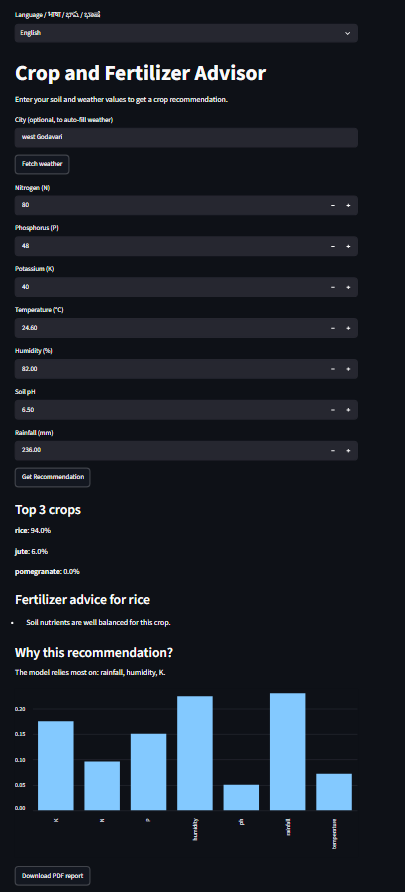
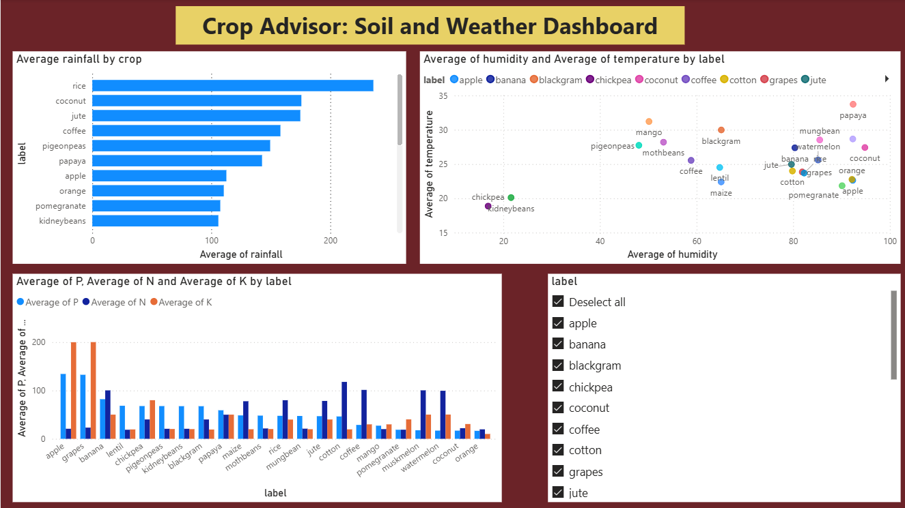

# Crop and Fertilizer Advisor

A web app that recommends the best crop and fertilizer from soil and weather values. Available in English, Telugu, Hindi and Kannada.

**Live app:** https://crop-fertilizer-advisor.streamlit.app

## Why I built this
Choosing the right crop and fertilizer is hard without a soil test. I built this app to give quick guidance from soil nutrients and weather, and added Telugu, Hindi and Kannada so it is easier for local farmers to understand. I also built it to practice the full machine learning workflow: data analysis, model comparison, a web app, and deployment.

## Features
- Top 3 crop recommendations with confidence scores
- Fertilizer advice based on low or high N, P, K
- "Why this recommendation" chart (feature importance)
- Weather auto-fill from a city name (Open-Meteo API)
- Low-confidence warning
- Downloadable PDF report
- Multilingual screen: English, Telugu, Hindi, Kannada
- Power BI dashboard of crop patterns

## Screenshots

## Models compared
| Model | Test accuracy | 5-fold cross-validation |
|---|---|---|
| Decision Tree | 98.0% | 98.7% |
| KNN | 98.0% | 97.1% |
| Random Forest | 99.5% | 99.5% |

Random Forest was chosen. Rainfall and humidity were the most important features, and pH the least.

## Tech stack
Python, pandas, scikit-learn, Streamlit, Power BI, fpdf2, Open-Meteo API

## Limitations
- Trained on a small, clean Kaggle dataset (2200 rows, 22 crops), so high accuracy may not hold on real farm data.
- Fertilizer advice is rule-based (below 80% or above 120% of the crop's average N, P, K), not agronomy-verified.
- Auto-filled weather is current conditions, while the model was trained on growing-season values.
- Rainfall must be entered by the user.
- This tool supports decisions and does not replace a soil test or a local agriculture officer.

## Run locally
'''
pip install -r requirements.txt
streamlit run app.py
'''

## Future work
Leaf disease detection from photos (CNN), more languages, PDF in regional languages.
